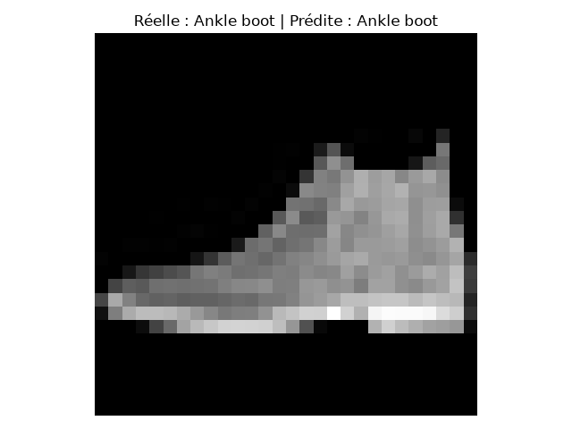
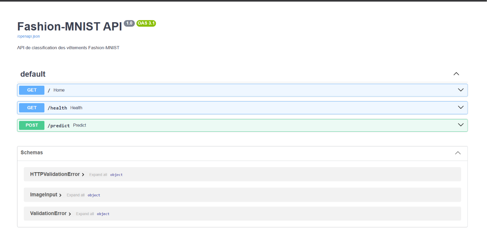
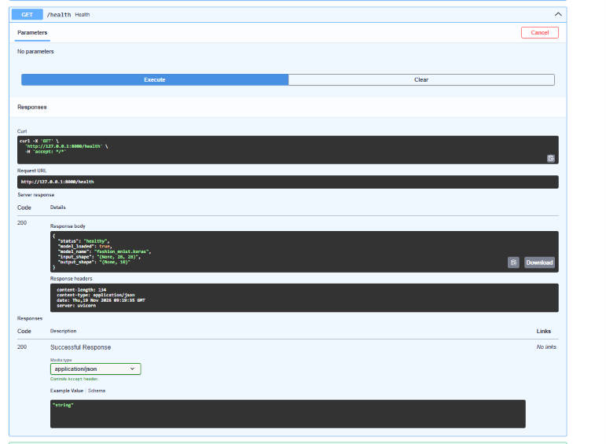
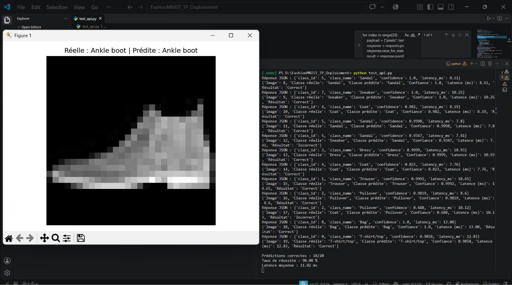
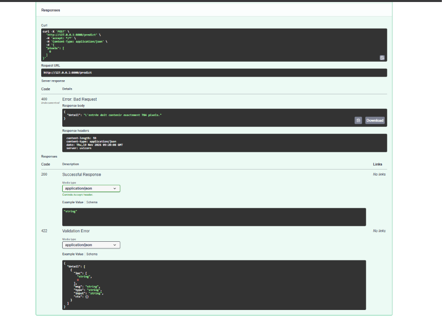

# Fashion-MNIST Classification API | FastAPI & TensorFlow

<p align="center">
  
</p>

<p align="center">
  <strong>Machine-learning inference service built with Python, FastAPI, and TensorFlow/Keras.</strong><br>
  Practical deployment project — ENSET Mohammedia, Master Systèmes Distribués et IA.
</p>

<p align="center">
  
  
  
  
</p>

## Overview

A REST API that serves a trained Fashion-MNIST neural network. Each request supplies **784 grayscale pixels** (a 28 × 28 image), and the model returns the predicted clothing category, confidence score, and measured inference latency. The model is loaded once when the server starts.

**Features:** inference via `POST /predict`, model-health monitoring, Swagger/OpenAPI documentation, range/shape validation, automated integration testing, and reproducible evaluation output.

## Results

| Metric | Observed result |
|---|---:|
| Evaluation sample | First 20 Fashion-MNIST test images |
| Correct predictions | **18 / 20** |
| Sample accuracy | **90%** |
| Average inference latency | **11.02 ms** (latest recorded run) |
| Earlier recorded run | 12.22 ms |
| Invalid request | **HTTP 400**, 3 pixels rejected |

> These numbers describe a **20-image smoke test**, not full test-set accuracy. Latency varies by machine and includes first-inference warm-up effects. The repository's `resultats_20_images.csv` preserves predictions and timings for a recorded run; rerunning the script produces new measurements.

The two incorrect predictions in the published CSV are **Sneaker → Sandal** (image 12) and **Coat → Pullover** (image 17).

## Screenshots and demonstration

### 1. Swagger / API documentation

The three available routes are documented automatically at `http://127.0.0.1:8000/docs`.



### 2. Health check — HTTP 200

`GET /health` reports model availability and input/output tensor shapes.



### 3. Predictions and evaluation

The integration test sends 20 images through the API, prints prediction JSON and calculates accuracy and average latency.



### 4. Invalid input — HTTP 400

The service explicitly rejects arrays that do not contain exactly 784 pixels.



## API reference

| Method | Route | Purpose |
|---|---|---|
| `GET` | `/` | Welcome message |
| `GET` | `/health` | Model status and shapes |
| `POST` | `/predict` | Image classification |

### Request contract

- Content type: `application/json`
- Body: `{"pixels": [/* exactly 784 numeric values */]}`
- Accepted values: grayscale pixel intensities between **0 and 255**, or values already normalized to **0–1**
- Reshape: `(1, 28, 28)`; if maximum value is greater than 1, divide by 255
- Prediction: Keras model in inference mode (`training=False`), followed by softmax over 10 logits

**Successful response (illustrative values):**

```json
{
  "class_id": 9,
  "class_name": "Ankle boot",
  "confidence": 0.9652,
  "latency_ms": 8.55
}
```

**Invalid input (observed HTTP 400):**

```json
{
  "detail": "L'entrée doit contenir exactement 784 pixels."
}
```

The 10 classes are: T-shirt/top, Trouser, Pullover, Dress, Coat, Sandal, Shirt, Sneaker, Bag, and Ankle boot.

## Setup and run

**Prerequisites:** Python 3.11 and a terminal (commands below are for Windows PowerShell). The trained `fashion_mnist.keras` model is included; there is no need to retrain it.

```powershell
# Clone
 git clone https://github.com/wijdane-ARB/FashionMNIST_TP_Deploiement.git
 cd FashionMNIST_TP_Deploiement

# Environment and packages
py -3.11 -m venv .venv
.\.venv\Scripts\Activate.ps1
python -m pip install -r requirements.txt

# Start API (leave this terminal running)
python -m uvicorn app:app --reload
```

Then open **[Swagger UI](http://127.0.0.1:8000/docs)** or **[Health endpoint](http://127.0.0.1:8000/health)** on the same computer.

In a **second terminal**:

```powershell
.\.venv\Scripts\Activate.ps1
python test_api.py
```

`test_api.py` loads the Fashion-MNIST test split (downloading it if not already cached), sends the first 20 images, writes `resultats_20_images.csv`, saves `image_testee.png`, and verifies the HTTP 400 validation response. Close the image window if the script is paused at `plt.show()`.

## Project structure

```text
FashionMNIST_TP_Deploiement/
├── app.py                  # FastAPI and inference logic
├── test_api.py             # Integration test on 20 images
├── fashion_mnist.keras     # Trained model
├── requirements.txt        # Dependencies
├── resultats_20_images.csv # Recorded evaluation sample
├── image_testee.png        # Sample visualization
├── captures/               # Screenshots used in this README
│   ├── swagger.png
│   ├── health.png
│   ├── prediction.png
│   ├── erreur_400.png
│   └── image_testee.png
├── docs/
│   └── Compte_Rendu_FashionMNIST_ENSET.pdf
└── README.md
```

## Technical report

[**Read the complete ENSET report (PDF)**](docs/Compte_Rendu_FashionMNIST_ENSET.pdf) — methodology, inference contract, results, error handling, and responses to the analysis questions.

## Scope

This repository contains a **locally runnable API**, not a publicly hosted inference endpoint. GitHub stores the source, model, documentation, and evidence; users need to start Uvicorn locally to call the API.

---

**Author:** Wijdane AARROUB · ENSET Mohammedia · Master Systèmes Distribués et Intelligence Artificielle
